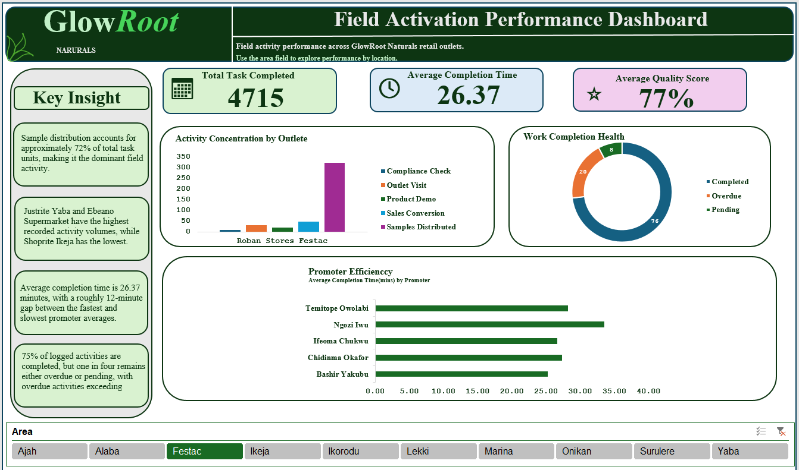
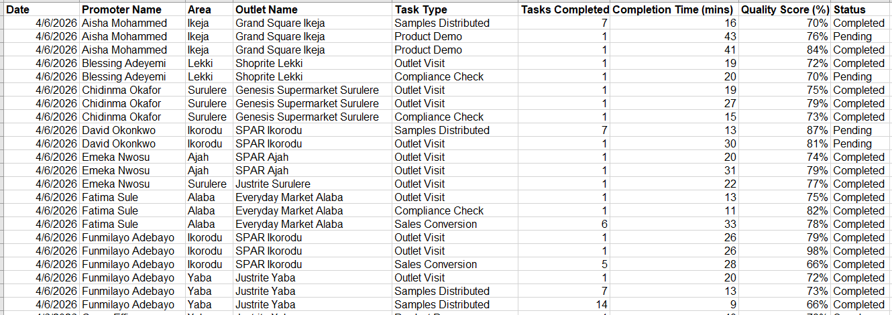
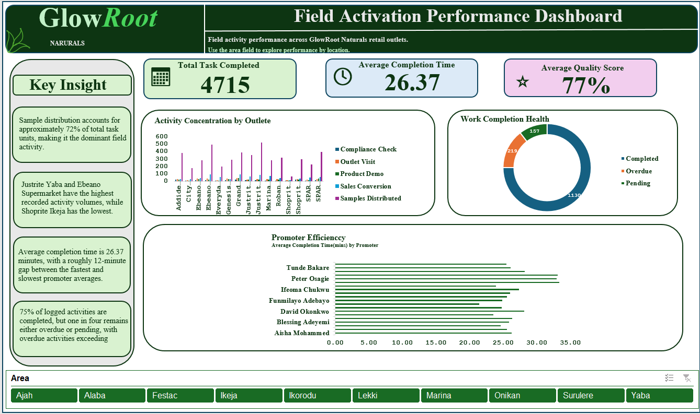

# Where Is GlowRoot's Field Effort Going, and How Much of It Gets Finished?

*Field Activation Performance Dashboard · Microsoft Excel · Retail Activation Analytics*

## Executive Summary

GlowRoot campaign is running at **75% completion**, but its effort is heavily skewed towards one activity and one half of its outlets carry most of the load.

**Sampling dominates the campaign.** Of the 6,498 task units logged, **4,681 (about 72%) are samples distributed**. Outlet visits account for 434 units, sales conversions for 821 (about 13%), product demos for 353 and compliance checks for 209. The field team is mostly handing out samples, and the log gives no way to tell whether that is leading to sales.

**Effort is unevenly spread across outlets.** Justrite Yaba (671), Ebeano Supermarket Lekki (665), Grand Square Ikeja (592) and SPAR Ikorodu (536) lead. Shoprite Ikeja logged only 116 units, less than a fifth of Justrite Yaba's. Whether that gap reflects footfall, promoter allocation or outlet requirements is the first thing management should establish.

**A quarter of the work is not done.** Of 1,506 records, **1,130 (75.0%) are completed**. The remaining 376 are outstanding: **219 overdue (14.5%) and 157 pending (10.4%)**. Overdue work outweighs pending work, which means more activities have already missed their expected completion point than are still waiting to start.

**Completion rates differ by area.** Yaba completes about 80.1% of its records, Lekki 75.3% and Onikan 73.6%. Lekki has the most overdue records of the three (34 of 235), a detail the campaign-wide 75% hides.

**Promoters take different amounts of time.** The overall average is **26.37 minutes** per activity, but individual promoter averages range from **21.39 to 33.33 minutes**. That is a spread of nearly 12 minutes. The data cannot say why, since task mix and outlet conditions both affect timing, so this is a prompt for follow-up and not a performance verdict.

**Quality is steady at 77%** on average across activities, which suggests the main issue is completion and distribution of effort, not the standard of the work that gets done.

**What this means for management:** clear the 219 overdue activities first, decide whether the 157 pending ones should be completed, rescheduled or reassigned, and investigate why outlet volumes differ so widely before moving promoters around. Finally, check whether the heavy sampling is turning into demos and sales conversions. 

## Business Context

GlowRoot Naturals is a skincare and haircare brand conducting an in-store promoter campaign across multiple retail outlets in Lagos.
Promoters record daily activities performed at different outlets, including:
- Outlet Visits 
- Compliance Checks 
- Product Demos 
- Sales Conversions 
- Samples Distributed.

The Trade Marketing team needs a simple way to understand:
- Where field activity is concentrated.
- How efficiently promoters are working.
- How much of the logged work is actually being completed.

## Objectives
The objective of this project is to transform GlowRoot Naturals' raw field activation activity log into an interactive Excel dashboard that enables management to:
- Monitor field activity volume. 
- Measure task completion. 
- Evaluate promoter completion times. 
- Monitor quality scores. 
- Compare activity across outlets and areas. 
- Identify overdue and pending activities. 
- Support operational decision-making using data.

  ## Data Overview

The source is a flat field activity log of **1,506 records across 9 columns**. Each row is one logged activity by a promoter at an outlet.
Before analysis, the data was converted to an Excel Table and checked for blank rows, duplicate records, data types and inconsistent text. The dataset has no information on customer traffic, task complexity, promoter experience or travel distance, which limits how far the results can be explained. See [docs/methodology.md](docs/methodology.md) for the full cleaning steps.

## Key Insights

**Sampling is the campaign.** Of 6,498 task units logged, 4,681 (about 72%) are samples distributed. Sales conversions (821) and product demos (353) are far smaller, so the campaign's output is overwhelmingly sampling.

**Effort is uneven across outlets.** Justrite Yaba (671), Ebeano Supermarket (665), Grand Square Ikeja (592) and SPAR Ikorodu (536) lead. Shoprite Ikeja logged just 116.

**About three-quarters of the work is done; a real backlog remains.** 1,130 of 1,506 records (75.0%) are completed. The other 376 are outstanding: **219 overdue (14.5%)** and **157 pending (10.4%)**. Overdue is the larger group, meaning those activities have already missed their expected completion point.

**Completion time varies between promoters.** The overall average is **26.37 minutes**, while promoter averages run from **21.39 to 33.33 minutes**.

**Completion rates differ by area**, which the totals hide:

| Area | Completed | Overdue | Pending | Records | Completion rate |
|---|---|---|---|---|---|
| Yaba | 185 | 25 | 21 | 231 | ~80.1% |
| Lekki | 177 | 34 | 24 | 235 | ~75.3% |
| Onikan | 39 | 5 | 9 | 53 | ~73.6% |

Average quality score across all activities is **77%**.

## Dashboard

## What I would recommend
- **Find out why outlet volumes differ so much.** Customer traffic, promoter allocation, outlet characteristics and campaign requirements are the first things to rule in or out.
- **Work the overdue list first**, then set a routine for reviewing it so items do not age.
- **Triage pending items:** complete, reschedule or reassign.
- **Do not judge promoters on completion time alone.** Compare against task mix, outlet and workload first.
- **Check whether sampling converts.** With 72% of effort in sampling, look at how Samples Distributed relates to Product Demos and Sales Conversions.

## Limits of this analysis
The data shows patterns, not causes. It has no customer traffic, task complexity, promoter experience or travel distance, so a longer completion time is not proof of lower productivity, and heavy sampling is not proof of campaign effectiveness. Treat the dashboard as a way to decide where to look next.

## How the dashboard works
KPI cards sit across the top, with a Key Insight panel on the left. The main visuals are a clustered column chart (outlet by task type), a doughnut of record status, and a horizontal bar chart of average completion time by promoter. The **Area slicer** (Ajah, Alaba, Festac, Ikeja, Ikorodu, Lekki, Marina, Onikan, Surulere, Yaba) filters all of them together.

To explore it, open the workbook, go to **Interactive_Dashboard** and click an area. KPI formulas are in the *cleaned_Dataset* sheet, columns M:N.

## Tools Used
* Microsoft Excel ( For data upload and analysis )
* Pivot tables ( For quick analysis)
* Pivot charts ( For Visualisation)

  ## Conclusion
  The GlowRoot Naturals Field Activation Performance Dashboard transforms a task-level field activity log into a centralized management view.
The analysis identifies three important dimensions of field execution:
Activity concentration — where and what type of work is being performed. 
Promoter efficiency — how long activities take to complete. 
Work completion health — whether logged activities are completed, overdue or pending. 
The analysis shows that sample distribution accounts for approximately 72% of recorded task units, while approximately 75% of activity records are completed. At the same time, 219 records are overdue and 157 remain pending, indicating a measurable outstanding workload.
The interactive Area slicer allows management to move from the overall campaign picture to area-level operational patterns, making the dashboard useful for routine field-performance monitoring and follow-up.

## Project Resources

- **Project WorkBook:** [View the Workbook](assets/Excel_WorkBook.xlsx)
- **PDF Project Report:** [Read the report](docs/Project_Report.pdf)
- **Live Dashboard:** [Open the GlowRoot interactive dashboard](assets/Dashboard.PNG)

## Contact

Lawrence Ruth: lawrenceruth34@gmail.com · [LinkedIn](https://www.linkedin.com/in/ruth-lawrence-8519073b7) · [GitHub](https://github.com/lawrenceruth)

*Glowroot Field Activation Performance Analysis is a portfolio project for learning and demonstration from LeadHer Foundation Instistute. Its results should not be read as commercial evidence.*
